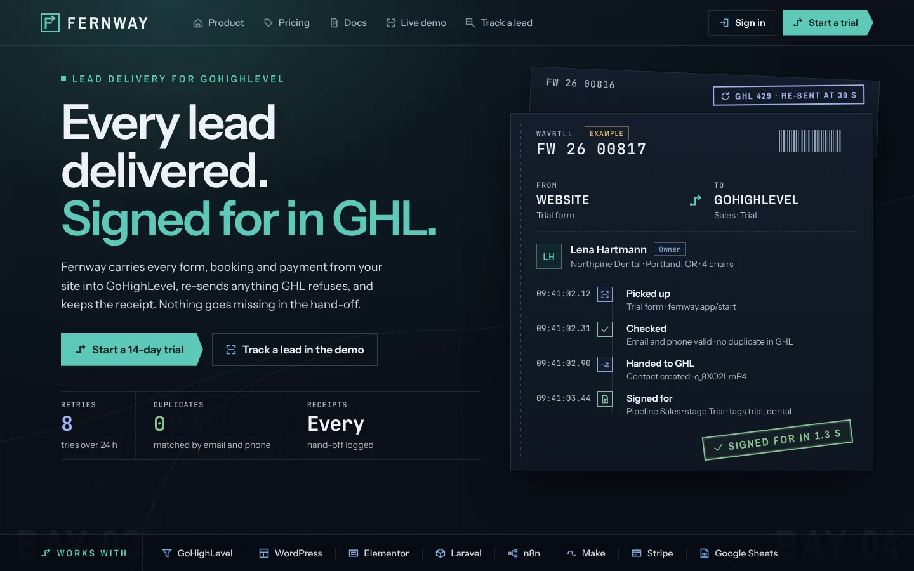
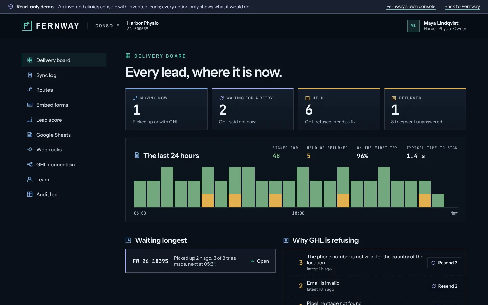
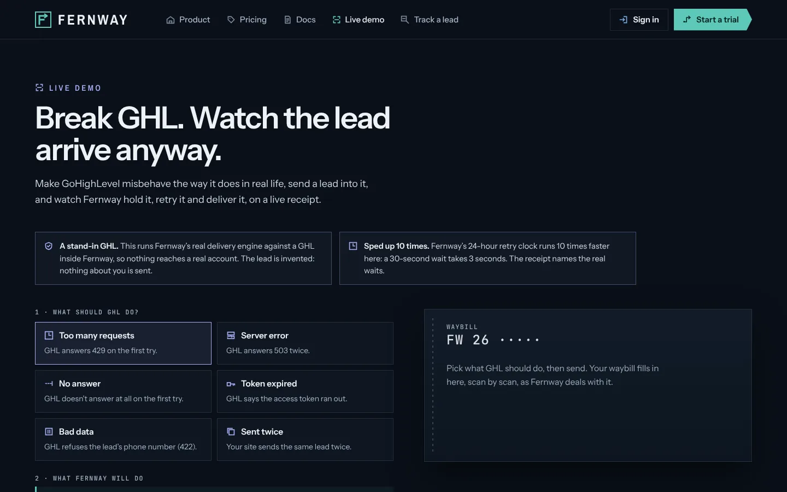
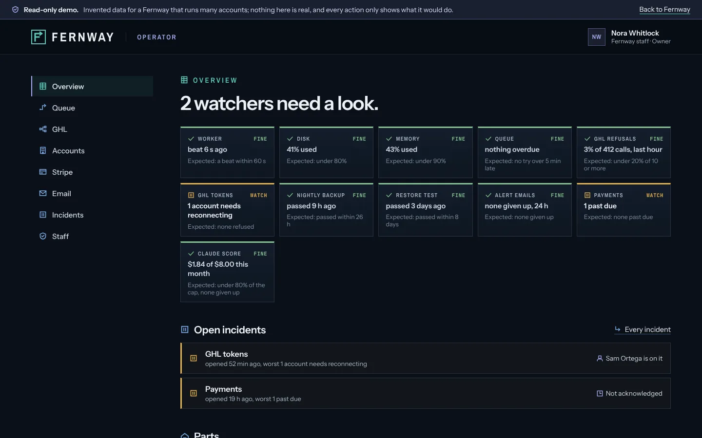

# Fernway

**Lead delivery for GoHighLevel.** Fernway carries every form, booking and payment from a website into GoHighLevel,
re-sends anything GHL refuses, and keeps a receipt for every hand-off. Each lead travels as a tracked waybill:
picked up, checked, handed to GHL, signed for.

Live at **[fernway.jeromebadour.com](https://fernway.jeromebadour.com)**. Built and run by
[Jerome Badour](https://jeromebadour.com).



## Try it without signing up

| | |
|---|---|
| [Break it](https://fernway.jeromebadour.com/break-it) | Make GHL answer 429, 503, a bad token or silence, send a lead, and watch Fernway hold it, retry it and deliver it on a live receipt. |
| [Console demo](https://fernway.jeromebadour.com/demo/console) | A customer's console with invented leads: the delivery board, why GHL refused, routes, webhooks, team. |
| [Operator demo](https://fernway.jeromebadour.com/demo/operator) | The console that runs Fernway itself: watchers, incidents, accounts, Stripe, email. |
| [Track a lead](https://fernway.jeromebadour.com/track) | Every lead's waybill, scan by scan. |
| [Alder & Pike Roofing](https://alderpike.jeromebadour.com) | A real WordPress site sending its form and bookings through Fernway into GHL. |



## What it does

- **Never loses a lead.** Every lead is written down before anything else happens. If GHL is busy, down or silent,
  the lead waits on a retry clock (8 tries over 24 hours) and the receipt says so.
- **Never sends one twice.** Every lead carries a key; a retry or a double click finds the same waybill, and GHL
  is matched by email and phone first.
- **Says why, in words.** When GHL refuses a lead, the console shows the reason ("The phone number is not valid
  for the country of the location") and a Resend button once it is fixed.
- **Books, scores and reports.** Bookings into GHL calendars at real free times, a lead score from Claude, Google
  Sheets in and out, signed webhooks out, Stripe billing with plans that only ever pause features, never delete.
- **Shows its own health.** A public [status page](https://fernway.jeromebadour.com/status), nightly backups, copied off
  the server encrypted, with a restore test every week, and a [changelog](https://fernway.jeromebadour.com/changelog) built from the real commits.



## Works with

| Tool | How | Docs |
|---|---|---|
| Any website | an embed form, or the REST API with a key | [/docs](https://fernway.jeromebadour.com/docs) |
| WordPress | a plugin with a form and bookings block, plus Elementor | [`integrations/wordpress`](integrations/wordpress) |
| Laravel | `composer require jeromebadour/fernway-laravel`: a queued job, events, signed webhooks | [`integrations/laravel`](integrations/laravel) |
| n8n and Make | ready flows that act on hot leads | [`integrations/n8n`](integrations/n8n), [`integrations/make`](integrations/make) |
| GoHighLevel | a marketplace app: OAuth, contacts, calendars, pipelines, workflow triggers | |
| Stripe | an account's own paid checkouts in as leads; Fernway's own plans through Checkout and the customer portal | |

## How it's built

| Path | What it is |
|---|---|
| `apps/web` | Next.js 16 and React 19: the public site, accounts, the console, the operator console, the API |
| `apps/worker` | the delivery worker (BullMQ on Redis): sends to GHL, retries, writes every scan |
| `packages/core` | shared rules: waybill numbers, the delivery promise |
| `packages/delivery` | the engine: Postgres through Drizzle, routes, plans, webhooks, Sheets, billing |
| `db` | Postgres migrations, applied on every deploy; the app connects as its own role, not the owner |
| `integrations` | WordPress (plugin, theme, the Alder & Pike site and its server setup), Laravel, n8n, Make |
| `ops`, `scripts` | Nginx, systemd timers, backups with offsite copies and restore tests, the deploy script |
| `.github/workflows` | CI and the merge gate |

One server runs it all in Docker Compose behind Nginx: web, worker, Postgres, Redis, plus the WordPress demo site
and n8n, each in its own project, listening only on the server itself so everything from outside goes through Nginx.



## How it's tested

Every change reaches `main` through a pull request, and a ruleset on `main` lets it merge only when both CI jobs
pass:

- **checks**: types, lint, and the unit and integration tests against a real Postgres and Redis, plus the Laravel
  package on PHP 8.2 with Laravel 12 and PHP 8.4 with Laravel 13.
- **container**: builds the real images, starts the whole stack with a stand-in GHL, and drives it end to end:
  accounts, the API, GHL refusing and recovering, bookings, plans, webhooks, a WordPress site with the plugin,
  a fresh Laravel app with the package, backups restored into an empty database, the Nginx config.

The server deploys only a commit CI passed on `main`, and [/delivery](https://fernway.jeromebadour.com/delivery)
links each promise about GHL failures to the test that proves it.

```bash
npm ci
npm run typecheck && npm run lint && npm run test:unit
```

## License

Fernway itself: all rights reserved (see `LICENSE`), published to read as part of Jerome Badour's portfolio.
The Laravel package in `integrations/laravel` is MIT, so any app may install and use it.
